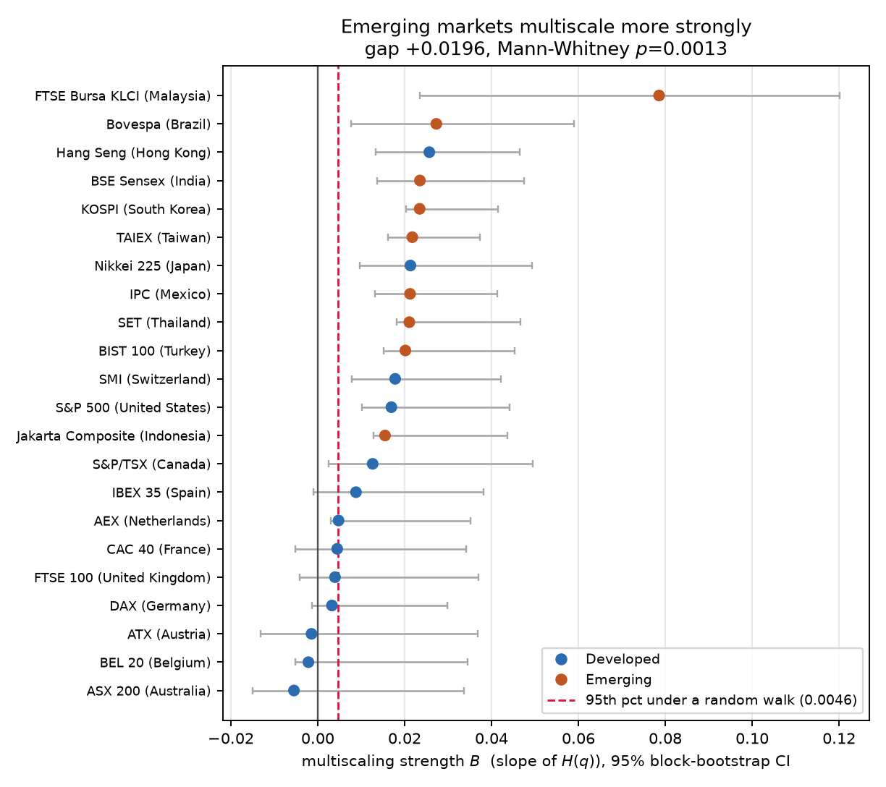
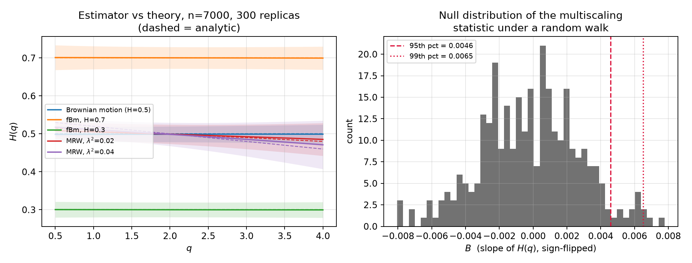
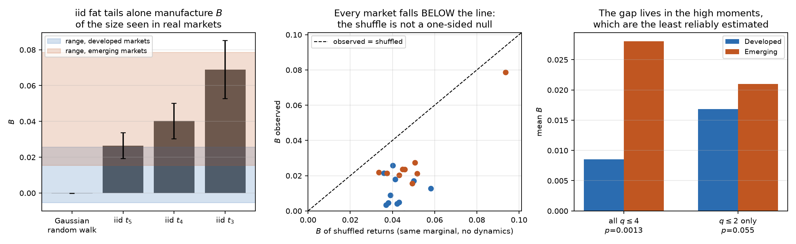
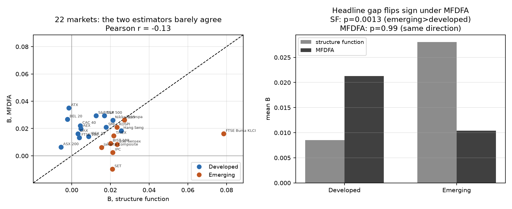
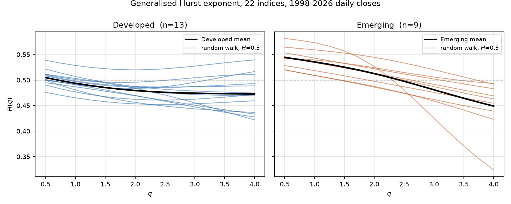

# Multiscaling in international equity indices

Estimates the generalised Hurst exponent `H(q)` for 22 national equity indices
(1998–2026, ~7,000 daily closes each), tests whether emerging markets multiscale
more strongly than developed ones, and then asks how much of that difference is
dynamics and how much is fat tails — using two structurally different
estimators to ask it.

For the reasoning behind every formula and function here — why `q` does what
it does, why the estimator is validated before it's trusted, why the shuffle
test isn't a fair null, and the second-estimator cross-check below — see
[`docs/THEORY.md`](docs/THEORY.md). For the same project explained five times,
simplest to most technical, see [`docs/EXPLAINER.md`](docs/EXPLAINER.md). For
a critical evaluation — comparison to the closest published precedent, the
economic arguments for and against reading the headline result as "real,"
data sourcing, and whether the timescale choice mattered — see
[`docs/EVALUATION.md`](docs/EVALUATION.md).

To read the actual code with a line-by-line explanation and run it yourself
against the real data, see [`notebooks/walkthrough.ipynb`](notebooks/walkthrough.ipynb)
(regenerate with `python3 notebooks/build_notebook.py` any time `src/` changes).

**Headline.** The textbook result replicates: multiscaling strength is more than
three times larger in emerging markets (mean `B` = 0.0281 vs 0.0085,
Mann–Whitney p = 0.0013), and the gap is stable across the fitting range and
robust to dropping the largest outlier. It is *not* explained away by tail
heaviness — in a joint regression the emerging-market dummy stays significant
after controlling for excess kurtosis (t = 3.6, p = 0.002, R² = 0.80).

**But the caveat is the interesting part, and it gets sharper.** The separation
is carried entirely by moments `q > 2`. Restricted to `q ≤ 2`, where sample
moments are reliably estimated, the gap shrinks by two thirds and stops being
significant (p = 0.055; p = 0.105 excluding Malaysia). An iid Student-t random
walk — a process with **no temporal structure at all** — produces `B` = 0.026
(df=5) to 0.069 (df=3), squarely inside the range measured on real markets.
And a second estimator (MFDFA), chosen because it is measurably less fooled by
that same fat-tail artefact, **does not find the gap at all** — point estimates
run the other way (developed `B`=0.0213 vs emerging `B`=0.0104, p=0.99),
consistently across a scale-range robustness grid. This is not a new worry:
Barúnik, Aste, Di Matteo and Liu reached the same "mostly fat tails, not
dynamics" conclusion on different data in 2012, by the same shuffle test used
here. See [§14 of THEORY.md](docs/THEORY.md#14-a-second-estimator-and-the-di-matteo-precedent-it-lands-on).



## Method

For log prices `X(t)`, the q-th order structure function

```
S_q(τ) = ⟨ |X(t+τ) − X(t)|^q ⟩_t        S_q(τ) ~ τ^(q·H(q))
```

`H(q)` is the slope of `log S_q(τ)` on `log τ`, divided by `q`, fitted over
τ = 1…19 days. `H(q)` flat in `q` is monofractal (`H` = 0.5 is a random walk);
`H(q)` falling in `q` is multiscaling. Multiscaling strength `B` is the
sign-flipped slope of a linear fit `H(q) = A − Bq` over q ∈ [0.5, 4].

Method and framing follow T. Di Matteo, *Multi-scaling in finance*,
Quantitative Finance **7**(1), 2007.

## The estimator is validated before it is used

`scripts/02_controls.py` runs 300 replicas of each process at the same sample
length as the data (n = 7,000):

| process | true H(q) | recovered H(1), H(2), H(4) | true B | measured B |
|---|---|---|---|---|
| Brownian motion | 0.5, flat | 0.4987, 0.4990, 0.4992 | 0 | −0.0002 ± 0.0029 |
| fBm, H = 0.7 | 0.7, flat | 0.7008, 0.7004, 0.6996 | 0 | +0.0004 ± 0.0035 |
| fBm, H = 0.3 | 0.3, flat | 0.3002, 0.3000, 0.2996 | 0 | +0.0002 ± 0.0020 |
| MRW, λ² = 0.02 | 0.51 → 0.48 | 0.5054, 0.4990, 0.4854 | 0.0100 | +0.0066 |
| MRW, λ² = 0.04 | 0.52 → 0.46 | 0.5113, 0.4987, 0.4711 | 0.0200 | +0.0132 |

Two things this buys:

1. **A null band.** Under a random walk at n = 7,000, `B` exceeds 0.0046 only 5%
   of the time. Six of the 13 developed indices sit below that line; all nine
   emerging indices sit above it.
2. **A known bias.** On the multifractal random walk, whose exponents are
   analytic, the estimator recovers **66%** of the true multiscaling — the same
   fraction at both λ², so it behaves as a calibration factor. Reported `B`
   values are lower bounds.



## The tail problem, and why the shuffle test fails

The standard check is to shuffle the returns: that destroys all temporal
structure while keeping the marginal distribution exactly, so any multiscaling
left over is an artefact. Here **every one of the 22 markets comes back with
*less* multiscaling than its own shuffled surrogate.**

That is not evidence against multifractality. Shuffling a multifractal random
walk — where the multiscaling is real by construction — does the same thing
(at λ² = 0.04, B rises from 0.0119 to 0.0366), because destroying volatility clustering
isolates the large moves while leaving the heavy unconditional marginal intact.
The plain shuffle is therefore a marginal-matched *benchmark*, not a one-sided
null, and the honest statistic is the excess `B − E[B_shuffled]`. The
developed/emerging ordering survives on that statistic too (p = 0.0097).



## A second estimator: MFDFA says the gap isn't there

Every check above stays inside one method. Multifractal Detrended
Fluctuation Analysis (Kantelhardt et al., 2002) estimates the same `h(q)` a
structurally different way — detrend non-overlapping windows locally, then
take the q-th moment of the detrended variance — and was validated the same
way as the main estimator (`scripts/02b_controls_mfdfa.py`, chosen scale
range `order=1, s_min=25, s_max=150` by screening against the same synthetic
processes as above).

Run on all 22 markets (`scripts/03b_estimate_mfdfa.py`), it reverses the
headline — developed `B`=0.0213 vs emerging `B`=0.0104, p=0.99 — consistently
across a 5-point scale-range robustness grid, with `B` (structure function)
and `B` (MFDFA) correlating at only `r`=−0.13 across the 22 markets.

Two easy explanations don't hold up: swapping Malaysia's single worst day for
its own median return *increases* MFDFA's B to 306% of its original value
(ruling out "it's just less sensitive to outliers"), and MFDFA distinguishes
slightly *more* individual markets from its own null than the structure
function does (16/22 vs 15/22 — not a power shortfall). What does hold up:
run through the same iid Student-t control as above, **MFDFA recovers only
30–50% of the spurious `B` that fat tails alone give the structure function**
(df=5: 0.008 vs 0.026; df=3: 0.035 vs 0.069 — `results/controls_iid_t_mfdfa.csv`).
MFDFA is measurably less fooled by the exact artefact already suspected above.

This matches a 2012 result, not a new one: Barúnik, Aste, Di Matteo and Liu,
*Physica A* 391(17), run the same shuffle test on stock indices, FX rates and
bond yields and conclude "most of the multifractality is caused solely by the
broad, fat-tailed distribution of the returns." §14 of `docs/THEORY.md` has
the full chain of reasoning.



## Results

| test | emerging | developed | gap | p |
|---|---|---|---|---|
| raw `B` | 0.0281 | 0.0085 | +0.0196 | 0.0013 |
| raw `B`, excluding Malaysia | 0.0218 | 0.0085 | +0.0132 | 0.0017 |
| excess over marginal-matched null | −0.0220 | −0.0343 | +0.0123 | 0.0097 |
| low moments only (`q ≤ 2`) | 0.0210 | 0.0169 | +0.0041 | 0.0545 |
| low moments, excluding Malaysia | 0.0191 | 0.0169 | +0.0023 | 0.1051 |

`τ_max` robustness — the gap holds across the whole plausible fitting range:

| τ_max | 10 | 15 | 19 | 25 | 30 |
|---|---|---|---|---|---|
| gap | +0.0206 | +0.0212 | +0.0196 | +0.0163 | +0.0128 |
| p | 0.0017 | 0.0007 | 0.0013 | 0.0038 | 0.0264 |



## Known limitations

- Uncertainty comes from a circular block bootstrap on returns (block ≈ n^⅓ ≈ 19
  days). Because block resampling breaks volatility correlation at block
  boundaries, it inflates `B` for the same reason shuffling does: the intervals
  in `fig4` are honest about **width** but are shifted upward, not centred on
  the point estimate. A wild or stationary bootstrap with a longer block would
  be the better tool.
- Developed/emerging is MSCI's classification, a coarse and partly political
  proxy for "market development". Hong Kong is classified developed and behaves
  like the emerging group; Malaysia (excess kurtosis 86, from the 1998 capital
  controls) is an extreme outlier and every result is reported with and without it.
- Indices are price levels in local currency, so currency crises enter as real
  price moves in some markets and not others.
- `_log_correlated_gaussian` clips negative circulant eigenvalues, which biases
  the MRW's realised covariance by 1–3% against theory. This is part of why the
  recovery figure is 66% rather than 100%.
- MFDFA's own null distribution is ~65% wider than the structure function's
  at this sample size, so its real-market bootstrap CIs are correspondingly
  wider; it is not underpowered overall, but any single market's MFDFA `B`
  carries more uncertainty than the headline estimator's.

## Reproducing

```bash
pip install -r requirements.txt
python scripts/01_download.py        # fetch + clean, writes data/clean/ and a quality report
python scripts/02_controls.py        # validate the estimator, figure 1
python scripts/02b_controls_mfdfa.py # validate MFDFA, choose its scale range, figure 1b
python scripts/03_estimate.py        # H(q) for 22 markets, bootstrap + surrogates (~1 min)
python scripts/03b_estimate_mfdfa.py # same, by MFDFA, plus the s_max robustness grid
python scripts/04_tails.py           # tails vs dynamics
python scripts/05_figures.py         # figures 2-5
```

`src/ghe.py` is the structure-function estimator (~150 lines); `src/mfdfa.py`
is the second, independent one; `src/synthetic.py` is the three validation
processes shared by both. Everything else is plumbing.

## References

- T. Di Matteo, "Multi-scaling in finance", *Quantitative Finance* **7**(1), 2007.
- T. Di Matteo, T. Aste, M. M. Dacorogna, "Long-term memories of developed and
  emerging markets", *Journal of Banking & Finance* **29**, 2005.
- E. Bacry, J. Delour, J. F. Muzy, "Multifractal random walk",
  *Physical Review E* **64**, 026103, 2001.
- J. Barunik, L. Kristoufek, "On Hurst exponent estimation under heavy-tailed
  distributions", *Physica A* **389**, 2010.
- J. W. Kantelhardt et al., "Multifractal detrended fluctuation analysis of
  nonstationary time series", *Physica A* **316**(1), 87–114, 2002.
- J. Barunik, T. Aste, T. Di Matteo, R. Liu, "Understanding the source of
  multifractality in financial markets", *Physica A* **391**(17), 4234–4251,
  2012.
