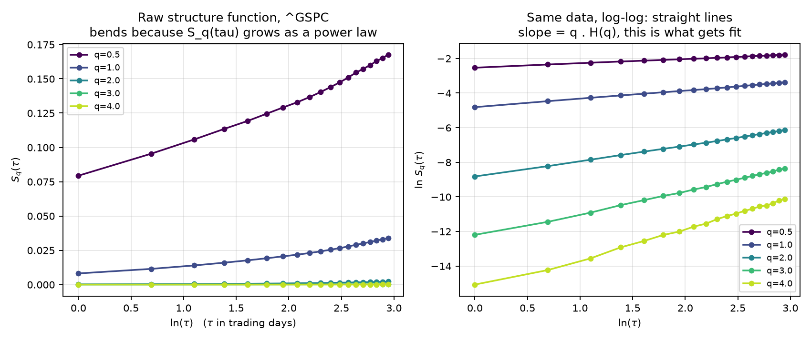
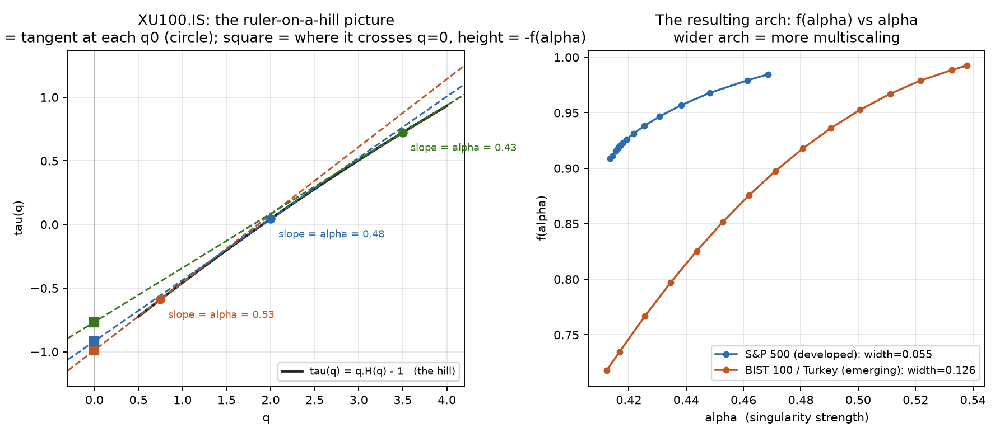

# Evaluation

A critical self-assessment of the project: how it sits against the closest
published precedent, why "a handful of extreme days" is the right place to
lay blame (and the economic arguments on both sides of that), where the data
came from, whether the timescale choice mattered, and a set of concept
explainers — written to correct a few specific errors that crept in from an
AI chat used alongside this project, not to duplicate `THEORY.md` or
`EXPLAINER.md`.

## 1. Comparison to Barunik, Aste, Di Matteo & Liu (2012)

§14 of `THEORY.md` already establishes that this project's shuffle-paradox
finding (§8) matches that paper's conclusion. Here is exactly what's shared
and what isn't, since "we got the same answer" is not the same claim as "we
did the same study."

**Shared:**
- The estimator (generalised Hurst exponent via structure functions).
- The diagnostic (shuffle surrogates: permute returns, keep the marginal,
  destroy time order).
- The headline conclusion of that diagnostic: shuffling *increases* measured
  multiscaling, on real data and on a synthetic process with real
  multiscaling, which rules out the naive reading ("multiscaling survives
  shuffling, so it must be real dynamics") and points at fat tails instead.

**Different — concretely, not just "different data":**
- **Their dataset** is the Dow Jones Composite 65 and the Nikkei 225 (both
  developed-market indices), GBP/USD and DM/USD, and five US Treasury
  tenors, June 1976 – November 2010. **This project's dataset** is 22
  national equity indices spanning both MSCI development tiers, 1998–2026.
  Their paper contains no developed/emerging comparison at all — both of
  their equity indices are developed markets. The specific question this
  project asks (does the *source* of multiscaling differ by a market's
  development stage?) is not one their 2012 paper could have answered with
  its own data, regardless of method.
- **Their estimator roster** is the generalised Hurst exponent only; MFDFA is
  cited once, in passing, as "its generalization" (Kantelhardt et al., 2002),
  and never run. The independent-estimator cross-check in this project's
  §14.2–14.4 — validate MFDFA the same way, run it on the same 22 markets,
  find it reverses the developed/emerging gap, and trace that reversal to a
  measured difference in each estimator's sensitivity to fat tails (§14.4's
  iid-Student-t comparison) — has no counterpart in their paper.
- **Their robustness axis** is the number of times they reshuffle (2 to 100)
  and which stochastic variable they use (price, absolute return, squared
  return). **This project's** robustness axes are the q-range restriction
  (§9), the τ_max grid (§6), the kurtosis regression (§10), and now the
  entire second estimator with its own independently chosen scale-range grid
  (§14.1).

**Net assessment.** This project replicates their mechanism and their
qualitative conclusion on independent data, then asks a question their paper
doesn't — whether that conclusion survives being pointed specifically at the
developed/emerging claim, under a second estimator chosen for being less
fooled by it. It doesn't. That's a genuine extension, not a restatement.

## 2. Why extreme days, specifically — the economic theory, both ways

§7–9 and §14 establish *statistically* that the developed/emerging gap in
`B` is carried by a handful of extreme days and doesn't survive a
tail-insensitive estimator. That's a measurement finding. It doesn't by
itself say whether those extreme days are economically *meaningful*
(a real structural feature of how emerging markets work) or economically
*incidental* (a historically contingent artefact of which 28 years got
sampled). Both readings have real support in the finance literature.

**The case that this reflects something real about market structure
(arguments *for*):**
- **Thin liquidity and shallow order books.** Emerging-market indices
  typically have fewer, less liquid constituents. A given-sized sell order
  moves the price further when there are fewer counterparties to absorb it
  — so the *same* shock, in dollar or information terms, produces a larger
  single-day move in a thinner market. This is a standard market-
  microstructure argument (bid-ask spreads, depth) and doesn't require any
  claim about investor behaviour.
- **Sudden stops and capital flight.** The "sudden stop" literature (Calvo,
  1998) describes a specific mechanism in emerging markets: foreign capital
  that arrived gradually can reverse almost instantly when sentiment turns,
  because the investor base is more concentrated and more willing to exit
  as a herd. That produces exactly the signature this project measures:
  ordinary days dominated by domestic flow, a handful of days dominated by
  a correlated, large, one-directional foreign exit.
- **Currency and capital-control regime changes.** Malaysia's extreme
  kurtosis (85.9, the project's own biggest outlier) traces to the 1998
  capital controls — a discrete policy event, not a continuous process. Many
  emerging markets in this sample have at least one such regime-change
  event in their history (currency pegs breaking, capital controls imposed
  or lifted, debt defaults) that developed markets in this sample mostly
  don't. If "multiscaling" is partly a proxy for "has this market had a
  regime-changing political/monetary event in the sample window," that is a
  real, economically meaningful difference — it's just not the "ongoing
  different dynamics" story the headline implies.
- **Weaker circuit breakers and market-making infrastructure.** Developed
  markets generally have more mature volatility-interruption mechanisms
  (circuit breakers, designated market makers obligated to quote through
  stress). Their absence or inconsistency in some emerging markets is a
  structural reason extreme days could be mechanically larger, independent
  of any difference in the underlying economic shock.

**The case that this is a sampling or compositional artefact, not a
persistent structural feature (arguments *against*):**
- **One-off events don't generalise.** A `B` dominated by the single largest
  move in a ~28-year sample is, by construction, dominated by whatever
  happened to occur in that window. Malaysia's 1998 event is an episode, not
  a rate — there is no reason to expect it to recur on the same schedule,
  and a different 28-year window could easily swap the ranking. This is
  precisely why the project reports every headline result with and without
  Malaysia (§11), and it's the same caveat in miniature for several other
  markets.
- **Index composition, not market dynamics.** A broad, diversified index
  like the S&P 500 (500 constituents) averages away idiosyncratic single-
  stock or single-sector shocks almost automatically; several of the
  emerging-market indices here have far fewer, more concentrated
  constituents. A large move in one dominant stock or sector can move the
  *whole index* in a thinner one — a mechanical, compositional reason for
  fatter index-level tails that has nothing to do with investor behaviour,
  memory, or market efficiency.
- **Survivorship and start-date asymmetry.** `data/clean/data_quality.csv`
  shows each index keeps its own trading calendar and history length; not
  every market has the full 1998–2026 window with the same data quality.
  Differences in how much history, and which specific historical era, each
  market contributes are themselves a possible source of a tail-driven
  gap that has nothing to do with the present-day structure of the market.
- **This project's own MFDFA and iid-Student-t evidence (§14) point the same
  way.** If the gap were really about persistent market dynamics (herding,
  memory, volatility clustering, as the *for* arguments above would predict),
  an estimator built to be less sensitive to a handful of extreme values
  should still find it — dynamics-driven multiscaling doesn't depend on any
  one day. It doesn't find it. That is evidence, not proof, that what's
  measured here leans toward the *against* column: specific historical tail
  events rather than an always-on structural property of "being an emerging
  market."

**Where this leaves the claim.** Both columns can be true in different
proportions for different markets in this sample — Malaysia likely belongs
mostly in the *against* column (one dateable event); a market with
persistently thin liquidity and weak circuit breakers across the whole
sample could genuinely belong in the *for* column even if this project's
aggregate statistics can't isolate it from the rest. The honest position,
consistent with §14.5, is that this dataset and these two estimators cannot
distinguish between the *for* and *against* stories — only a country-by-
country structural analysis (liquidity measures, index concentration,
dated regime-change events) could, and that is explicitly out of scope here.

## 3. Where the market data came from

All 22 series are daily closing index levels fetched from **Yahoo Finance**
via the `yfinance` Python package (`scripts/01_download.py`), `auto_adjust=
False` (these are price indices with no dividend stream to adjust for), date
range **1998-01-01 to 2026-07-17** (the common window across all 22 feeds;
Thailand's SET is the binding constraint, its Yahoo feed ending 2026-07-17).
Each index keeps its own trading calendar rather than being forced onto a
shared one — deliberately: aligning 22 different holiday calendars and
forward-filling would insert runs of identical consecutive closes on days
one market is open and another is on holiday, which mechanically suppresses
small-τ structure functions and biases `H(q)`. Any series with more than 1%
"stale" days (a close identical to the previous close, usually a feed
repeating its last print through a gap) is dropped rather than cleaned
in place — `data/clean/data_quality.csv` has the per-market figures.
Developed/emerging classification follows **MSCI's** market classification
as of 2026 — a published, standard taxonomy, but (as §11's limitations
already note) a coarse and partly political one; Hong Kong is classified
developed by MSCI and behaves like the emerging group here.

## 4. The timescale, τ, and whether it mattered

`τ` is the lag, in trading days, between the two price observations that
make an increment — not a window you average inside, just the gap `X(t+τ) −
X(t)`. The headline estimator fits across **τ ∈ [1, 19] trading days**
(roughly one day to one calendar month), chosen because the log-log
relationship in `S_q(τ)` is visibly straight across that range (`fig2`, and
the new `fig7` below) without running long enough for the power-law
assumption to plausibly break down.

**Did it matter?** Yes, somewhat, and the project checks this explicitly
rather than asserting the choice is safe (§6): re-running the entire
estimation at `τ_max ∈ {10, 15, 19, 25, 30}` gives

| τ_max | 10 | 15 | 19 | 25 | 30 |
|---|---|---|---|---|---|
| developed/emerging gap in B | +0.0206 | +0.0212 | +0.0196 | +0.0163 | +0.0128 |
| p-value | 0.0017 | 0.0007 | 0.0013 | 0.0038 | 0.0264 |

The gap survives everywhere in this range, but it *shrinks* monotonically as
`τ_max` grows — weaker evidence of real multiscaling at longer horizons,
consistent with §14's conclusion that much of the effect is a short-horizon,
few-extreme-days phenomenon rather than something that keeps compounding
over longer windows.

**MFDFA's scale range is a different axis entirely, and that comparison is
informative too.** MFDFA's `s` is not the structure function's `τ` — `s` is
the width of a detrending *window*, not a lag — and §14.1 chose `s_min=25,
s_max=150` (25–150 trading days, i.e. five weeks to seven months) by
screening against synthetic processes, landing on a *wider* and *later-
starting* range than the structure function's 1–19 days. That MFDFA
disagrees with the structure function is therefore not fully separable from
the fact that the two methods are, in part, asking about different horizons
— one more reason (on top of §14.5's own caveat) that the disagreement
doesn't straightforwardly mean one method is "right."

## 5. Concept explainers

### 5.1 What a Hurst exponent is

Named for Harold Edwin Hurst, a hydrologist who studied how far the Nile's
annual flood levels could deviate from their long-run average before a dam
would overflow (Hurst, 1951) — not originally a finance concept at all. For
a time series, `H` is a single number, usually between 0 and 1:

- **H = 0.5** — a plain random walk. No memory: knowing today's move tells
  you nothing about tomorrow's direction.
- **H > 0.5** — persistent. A move in one direction tends to be followed by
  more movement in the same direction.
- **H < 0.5** — anti-persistent. A move tends to be followed by a reversal.

In a monofractal process, one `H` describes the whole series at every scale.
This project's whole premise is that real markets often don't behave that
way — `H` depends on which `q` you ask it with — which is exactly why the
estimator here returns a curve, `H(q)`, not a single number.

**A correction, since this came up directly:** some explanations in
circulation define the multiscaling-strength statistic as a two-point
difference, `B = H(q_min) − H(q_max)` (e.g. `H(−5) − H(+5)`), and describe
"high" multiscaling as `B > 0.4`. **That is not this project's `B`.** Here,
`B` is the sign-flipped slope of an ordinary-least-squares fit through the
*entire* `H(q)` curve across `q ∈ [0.5, 4]` (`ghe.multiscaling_strength`,
§4 of THEORY.md) — using all 15 fitted points, not just the two endpoints,
specifically because a two-point difference would be much noisier (it was
checked explicitly: `h1_minus_h4`, `H(1) − H(4)`, is computed alongside `B`
and agrees with it on every market, but is reported as the secondary, not
primary, statistic for exactly this reason). The two conventions also live
on completely different numeric scales: because this project's `q` only
spans `[0.5, 4]` rather than `[−5, 5]`, and uses a full-curve slope rather
than an endpoint gap, real `B` values here run from about **0.002 to 0.08**
(see `results/summary.csv`) — nowhere near the `0.1–0.4+` range that
two-point, wider-q-range convention would produce. If you quote a `B` value
from this project anywhere, it is a slope, over `q ∈ [0.5,4]`, and the
`>0.4 = high multiscaling` rule of thumb from that other convention does not
transfer.

### 5.2 What `q` is — and why it's a telescope filter, not a magnifying glass

`q` is not a timescale. The timescale is `τ` (how far apart in time the two
prices you're comparing are). `q` is a completely separate dial: it decides
which *size* of price move the statistic should pay attention to, at
whatever timescale you've fixed.

Think of it like choosing a filter on a telescope pointed at a galaxy. The
*zoom* — how much of the sky you're framing, a single star cluster versus
the whole galaxy — is `τ`. The *filter* you drop in front of the lens is
`q`: switch to a filter that only lets through faint, ordinary starlight,
and the quiet, everyday structure dominates the image; switch to a filter
tuned to high-energy emission, and the picture is suddenly dominated by the
rare, violent events — supernovae, flares — while the ordinary stars barely
register at all. The galaxy didn't change. What you chose to expose for
did.

Mechanically: the estimator raises each price move to the power `q` before
averaging, `|ΔX_τ|^q`. At low `q` (like 0.5), a small move and a huge move
contribute similarly, so the average reflects typical, everyday behaviour.
At high `q` (like 4), a 1% day contributes almost nothing (`0.01^4` is
tiny) while a 10% day contributes enormously (`0.10^4` is 10,000× larger) —
so the statistic is effectively exposing only for crashes, filtering out
everything else. Scanning `q` from 0.5 to 4, as this project does, is
sweeping that exposure filter from "ordinary conditions" to "crisis only"
and checking whether the market looks structurally different depending on
which one you chose. That it does — `H(q)` falls as `q` rises — is the
entire empirical finding this project started from.

### 5.3 S_q(τ) against ln(τ), shown directly

Left: the raw structure function, `S_q(τ)` plotted against `ln(τ)` directly,
for the S&P 500 at five values of `q`. Every curve bends upward — `S_q(τ)`
is growing as a power law in `τ`, not linearly, so a plot against `ln(τ)`
(not `ln S_q(τ)`) still curves. Right: the same data with the y-axis also
logged, `ln S_q(τ)` against `ln(τ)` — now every curve is a straight line,
which is the whole point of working in log-log space: the slope of that
straight line, divided by `q`, *is* `H(q)`. This is the literal picture
behind every `H(q)` value reported anywhere in this project.

### 5.4 What a block bootstrap is, and specifically which one this project uses

A plain bootstrap resamples individual data points independently. Applied to
daily returns, that's a problem: real returns aren't independent (a crash
day tends to be followed by more turbulence — "volatility clustering"), and
shuffling individual days destroys exactly that structure, which is what
you're trying to measure. A **block bootstrap** fixes this by resampling
whole contiguous chunks ("blocks") of consecutive days instead of single
days, so the clustering *within* a block survives being resampled.

There are several standard variants — moving/overlapping blocks,
non-overlapping blocks, and the stationary bootstrap (randomised block
length). **This project uses a *circular* block bootstrap**
(`ghe.circular_block_bootstrap`): blocks of fixed length (≈20 trading days,
from `max(20, n^(1/3))`) are drawn with replacement from random starting
points in the series, wrapping around from the end back to the start (via
`% n`) rather than stopping at the boundary — so every day in the original
series, including those near the very end, has an equal chance of starting
a block. This is a specific, named variant (circular block bootstrap,
Politis & Romano) distinct from all three described above, chosen because it
avoids the boundary-length irregularities of a plain moving-block scheme
while still being simpler than the stationary bootstrap's randomised block
length. §11's limitations section is explicit about what this choice costs:
resampling at fixed block boundaries still breaks correlation *across* those
boundaries, which is documented as shifting the resulting confidence
intervals upward rather than centring them on the point estimate — the
intervals are honest about width, not about being centred.

### 5.5 The Legendre transform, via the project's own numbers

**Left panel — the "ruler on a hill" picture, drawn from real data (BIST
100 / Turkey).** The solid black curve is `τ(q) = q·H(q) − 1` — the "mass
exponent," a direct transform of the `H(q)` curve this project already
estimates. It curves, gently, because `H(q)` isn't flat. At three points
along it (`q`=0.75, 2.0, 3.5), a straight ruler is laid against the curve —
its tangent line, dashed. The *slope* of that ruler at a point is `α`, the
**Hölder exponent**: here it's 0.53 at the low-`q` (ordinary-day) end and
0.43 at the high-`q` (crash) end — the curve's slope is shrinking as `q`
grows, which is the geometric fingerprint of the same effect `H(q)` falling
already showed. Extend each ruler leftward to where it crosses `q=0`
(the square markers) and read off its height: that height is exactly
`−f(α)`, where `f(α) = q·α(q) − τ(q)` is the Legendre transform. This isn't
a metaphor standing in for the algebra — it's the literal geometric meaning
of the formula: the transform *is* "read off where each tangent line hits
the axis."

**Right panel — the resulting arch, for two real markets.** Sweeping the
ruler continuously along `τ(q)` and plotting every `(α, f(α))` pair traces
out the singularity spectrum. The S&P 500's arch is narrow (width `Δα` =
**0.055**); Turkey's is more than twice as wide (**0.126**) — a visual,
geometric restatement of the same gap the project's `B` statistic measures
numerically. `ghe.singularity_spectrum` computes exactly this, and
`THEORY.md` §5 ("does the project need a singularity spectrum too") already
flags the same caveat visible here: `α` is a *derivative* of a 15-point
curve, so it's noisier than `H(q)` itself, and that noise concentrates at
exactly the high-`q` end this project's own §7–9 already show is least
trustworthy. The arch is a genuinely useful picture; it was deliberately
kept as a secondary diagnostic, not the headline statistic, for that reason.

### 5.6 What the Mann–Whitney test is, and what the p-values here mean

Mann–Whitney (also called Wilcoxon rank-sum) tests whether two independent
groups' values come from the same distribution, without assuming either
group is normally distributed — important here because a t-test's normality
assumption would be badly broken by Malaysia's outlier. The test's logic:
rank every value from both groups together, then ask how extreme the sum of
ranks in one group is compared to what you'd expect if group membership
(developed vs emerging) were assigned at random. Concretely, for this
project's headline test: **pick one emerging-market `B` and one
developed-market `B` at random; under the null hypothesis of no real
difference, the emerging one is larger exactly 50% of the time.** The
reported **p = 0.0013** means that if there really were no difference,
a split at least this lopsided (13 developed, 9 emerging, emerging
systematically ranking higher) would arise by chance in roughly 13 of every
10,000 random relabellings of which market is "developed" and which is
"emerging." It says nothing about *why* the groups differ — §2 above exists
to chase that separately — and (a common misreading) it is not "a 0.13%
chance the null hypothesis is true."

## Bibliography

Every source cited across this project (`THEORY.md`, `EXPLAINER.md`, this
file), in one place.

**Method and headline comparison:**
- T. Di Matteo, "Multi-scaling in finance," *Quantitative Finance* 7(1),
  21–36, 2007.
- T. Di Matteo, T. Aste, M. M. Dacorogna, "Long-term memories of developed
  and emerging markets: using the scaling analysis to characterize their
  stage of development," *Journal of Banking & Finance* 29(4), 827–851,
  2005.
- J. Barunik, T. Aste, T. Di Matteo, R. Liu, "Understanding the source of
  multifractality in financial markets," *Physica A* 391(17), 4234–4251,
  2012.

**Further publications reaching a similar conclusion (tails, not dynamics,
as the dominant source of apparent multifractality):**
- Z.-Q. Jiang, W.-X. Zhou, "Multifractality in stock indexes: fact or
  fiction?" *Physica A* 387(14), 3605–3614, 2008. Four indices (HSI, SZSC,
  S&P 500, NASDAQ), intraday data; finds original and shuffled series'
  scaling behaviour statistically indistinguishable.
- J. Barunik, L. Kristoufek, "On Hurst exponent estimation under
  heavy-tailed distributions," *Physica A* 389(18), 3844–3855, 2010. The
  finite-sample bias mechanism behind this project's iid-Student-t control.

**Estimators:**
- E. Bacry, J. Delour, J.-F. Muzy, "Multifractal random walk," *Physical
  Review E* 64, 026103, 2001. (The `src/synthetic.py` positive control.)
- J. W. Kantelhardt, S. A. Zschiegner, E. Koscielny-Bunde, S. Havlin,
  A. Bunde, H. E. Stanley, "Multifractal detrended fluctuation analysis of
  nonstationary time series," *Physica A* 316(1), 87–114, 2002. (The method
  behind `src/mfdfa.py`.)
- H. E. Hurst, "Long-term storage capacity of reservoirs," *Transactions of
  the American Society of Civil Engineers* 116, 770–799, 1951. (Origin of
  the Hurst exponent, outside finance.)

**Statistics:**
- D. N. Politis, J. P. Romano, "The stationary bootstrap," *Journal of the
  American Statistical Association* 89(428), 1303–1313, 1994. (Block
  resampling for dependent time series; the family `circular_block_bootstrap`
  belongs to.)
- H. B. Mann, D. R. Whitney, "On a test of whether one of two random
  variables is stochastically larger than the other," *Annals of
  Mathematical Statistics* 18(1), 50–60, 1947. (The developed/emerging
  significance test, §9/§5.6.)

**Data:**
- Daily index closes, Yahoo Finance, retrieved via the `yfinance` Python
  package (`scripts/01_download.py`).
- MSCI market classification (developed/emerging tier assignment), as of
  2026.
